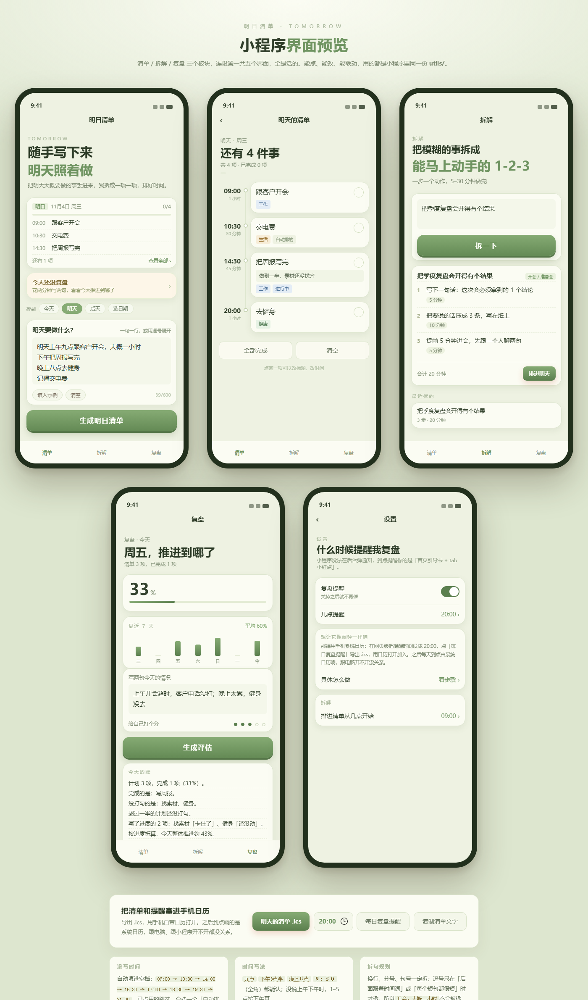

# 明日清单 · 微信小程序

> 把要做的事丢进去，它替你排好时间；晚上花两分钟复盘，自动写成 Markdown 日记。

清单 / 拆解 / 复盘 三个板块。数据全在手机本地，不需要服务器就能跑；
可选接入云开发，把日记推到 GitHub、让拆解交给 DeepSeek、每晚微信提醒。

**代码在 [`tomorrow-plan-miniprogram/`](tomorrow-plan-miniprogram/) 里。**

| 想了解 | 看这里 |
| --- | --- |
| 功能、目录、怎么跑起来 | [README](tomorrow-plan-miniprogram/README.md) |
| 配色 / 字号 / 圆角 / 语气 | [DESIGN.md](tomorrow-plan-miniprogram/DESIGN.md) |
| 上线到微信、云开发、订阅消息、Pages | [部署指南](tomorrow-plan-miniprogram/部署指南.md) |

**快速开始**：微信开发者工具 → 导入项目 → 选 `tomorrow-plan-miniprogram` → 填 AppID → 编译。
不想装工具？直接用浏览器打开 [`preview.html`](tomorrow-plan-miniprogram/preview.html)。

---

改完代码双击仓库根目录的 **`push.bat`** 就能提交并推送。
