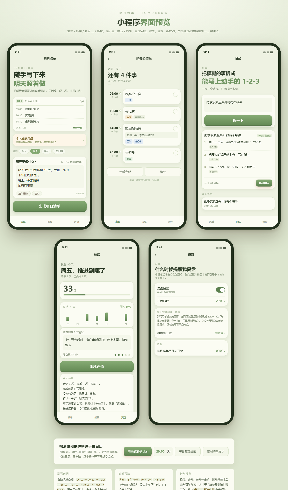

# 明日清单 · 微信小程序

> 把要做的事丢进去，它替你排好时间；晚上花两分钟复盘，自动写成 Markdown 日记。



## 三个板块

| | 做什么 |
| --- | --- |
| **清单** | 写「明天上午九点开会」，自动拆成带时间的条目；没写时间的塞进空档 |
| **拆解** | 一句模糊的目标 → 三个马上能动手的动作。本地模板先出，配了 DeepSeek 会更好 |
| **复盘** | 写两句今天的情况，生成一份**中性**的「今天的账」——只陈述事实，不夸不骂不建议 |

## 几个特点

- **数据全在手机本地**，不联网也能用；不需要服务器就能跑
- **可以指定日期**，不只明天：今天 / 明天 / 后天 / 任意一天
- 清单能**导出 `.ics`** 进手机日历，到点由系统响铃
- 日记能**自动推到 GitHub**，配合 Obsidian Git 插件直接落进 vault
- 拆解接了 **DeepSeek**（可选），key 只在云函数里，不进小程序

## 快速开始

1. 装 [微信开发者工具](https://developers.weixin.qq.com/miniprogram/dev/devtools/download.html)
2. 导入项目 → 选这个文件夹 → AppID 填自己的（或先点「测试号」看界面）
3. 编译

想看界面但不想装工具？用浏览器打开 `preview.html`，逻辑和样式跟小程序是同一份。

## 目录

```
app.js / app.json / app.wxss     入口与全局样式
pages/     index · plan · breakdown · review · settings
utils/     parser · breakdown · review · progress · diary · ics · ai · store · date · cloud
cloudfunctions/   pushDiary（日记推 GitHub）· askAI（DeepSeek 转发）· dailyReminder（每晚提醒）
tests/     216 条用例
DESIGN.md  视觉规范
部署指南.md 上线到微信 / 云开发 / 推送
```

## 能听懂什么

```
明天上午九点跟客户开会，大概一小时   → 09:00 跟客户开会 · 工作 · 60 分钟
下午把周报写完                    → 14:30 写周报
记得交电费                       → 自动排到最近空档
买菜，写周报，健身                 → 拆成 3 项
```

进度也可以随手写一句：「做了一半，卡在等数据」→ 判定成**卡住了**，而不是进行中。

## 测试

```bash
node tests/parser.test.js      # 解析
node tests/progress.test.js    # 进度判定
node tests/review.test.js      # 复盘口径（含「不许夸不许骂」断言）
node tests/diary.test.js       # Markdown 日记
node tests/ics.test.js         # 日历文件
node tests/app.smoke.js        # 五个页面流程 + WXML 绑定对账
```

共 216 条，不需要微信开发者工具也能跑。

## 更多

- 视觉规范（配色、字号、圆角、语气）见 [DESIGN.md](DESIGN.md)
- 上线、云开发、订阅消息、GitHub Pages 见 [部署指南.md](部署指南.md)
